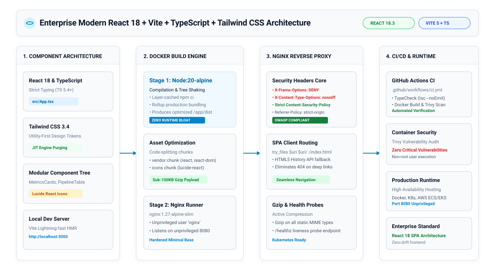

# Modern React 18 Enterprise Operations Dashboard

[](https://github.com/tayyabmasood911/modern-react-app/actions)
[](SECURITY.md)
[](LICENSE)
[](https://react.dev)
[](https://vitejs.dev)
[](https://tailwindcss.com)

A production-grade, modular cloud operations and DevSecOps management console built with React 18, Vite 5, TypeScript 5, and Tailwind CSS. Packaged in a hardened multi-stage Docker container served by an unprivileged Nginx reverse proxy with OWASP security headers.

---

## Architectural Blueprint

The application employs a lightning-fast Vite build system coupled with an unprivileged Alpine Nginx container runtime implementing single-page application (SPA) routing, active gzip compression, and strict security headers:



---

## Key Capabilities & Tech Stack

- **React 18.3 & TypeScript 5:** Strict type safety, clean component hierarchy, and responsive UI components.
- **Tailwind CSS 3.4 & Lucide Icons:** Modern utility-first styling with customized enterprise color tokens and iconography.
- **Multi-Stage Containerization:** `node:20-alpine` compilation stage with dependency layer caching, producing a minimal static output served by `nginx:1.27-alpine-slim`.
- **Hardened Nginx Reverse Proxy:** Unprivileged runtime execution (`USER nginx`, port 8080), single-page application fallback routing (`try_files $uri $uri/ /index.html`), gzip compression, and `/healthz` liveness probes.
- **Enterprise Security Headers:** Active CSP, `X-Frame-Options DENY`, `X-Content-Type-Options nosniff`, and `Referrer-Policy strict-origin-when-cross-origin`.

---

## Quick Start & Local Development

### Prerequisites
- Node.js 20.x or higher
- npm 10.x or higher

### Local Development
```bash
# Clone the repository
git clone https://github.com/tayyabmasood911/modern-react-app.git
cd modern-react-app

# Install dependencies
npm install

# Start local Vite development server with Hot Module Replacement (HMR)
npm run dev
# -> Local server available at http://localhost:3000
```

### Production Build & Preview
```bash
# Type check and build static bundle
npm run build

# Preview production build locally
npm run preview
```

---

## Docker & Container Deployment

### 1. Build Multi-Stage Production Container
```bash
docker build -t modern-react-app:latest .
```

### 2. Run Container Locally
```bash
docker run -d -p 8080:8080 --name react-dashboard modern-react-app:latest

# Verify healthcheck endpoint
curl http://localhost:8080/healthz
# -> Returns: OK
```

---

## Local Verification & Testing

```bash
# Execute Python unit test suite
python3 -m unittest discover -s tests -p "test_*.py"

# Typecheck code
npx tsc --noEmit
```

---

## Security Governance & Disclosure

For vulnerability reports or security disclosures, review our [Responsible Disclosure Policy](SECURITY.md) or email maintainer **Tayyab Masood** at [tayyabmasood911@gmail.com](mailto:tayyabmasood911@gmail.com).

---

## License

Licensed under the MIT License. See [LICENSE](LICENSE) for details.
